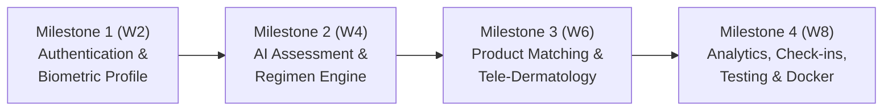

# 🎬 AI Skin Intelligence & Personalized Skincare Planner
## Final Presentation & Milestone 4 Capstone Showcase

---

## Slide 1: Title & Overview
- **Project Title**: AI Skin Intelligence & Personalized Skincare Planner
- **Target Audience**: Consumers, Dermatology Clinics, Beauty Brands, Telehealth Providers
- **Core Value Proposition**: Clinically grounded, AI-assisted skincare intelligence that translates user biometrics, lifestyle factors, and high-resolution facial check-ins into individualized regimens and tele-dermatology triage.

---

## Slide 2: The Skincare Dilemma & Our Solution
### The Problem:
- Skincare consumers suffer from trial-and-error purchasing, ingredient contraindications, and delayed dermatological consultations.
- Generic routines fail to account for environmental stress, sleep deprivation, or localized skin lesions.

### The Solution:
- A closed-loop clinical platform uniting **Biometric Profiling**, **Computer-Assisted Lesion Telemetry**, **Formulation Pharmacopoeia Intelligence**, and **Tele-Dermatology Clinical Oversight**.

---

## Slide 3: Milestone Journey (Weeks 1 – 8)

- **Milestone 1**: Native bcrypt security, JWT auth, 9-point biometric profile.
- **Milestone 2**: Multi-factor clinical scoring, morning/evening/weekly protocols, explainable AI triage.
- **Milestone 3**: Bio-actives pharmacopoeia, multi-product formulation comparison, tele-dermatology queue.
- **Milestone 4**: Live webcam check-in, structured lesion observations, executive telemetry, automated pytest suites, and Docker containerization.

---

## Slide 4: Key Technical Highlights

1. **Native Security Architecture**:
   - Replaced passlib bcrypt wrapper with native Python `bcrypt` for resilient authentication without 72-byte string buffer panics.
2. **Dual Database Adaptability**:
   - Zero-configuration SQLite for rapid local prototyping + production-grade PostgreSQL support via standard `DATABASE_URL`.
3. **Computer-Assisted Skin Check-in**:
   - Real-time browser webcam video stream capture via `HTML5 getUserMedia` + canvas rasterization alongside image upload.
   - Algorithmic image quality check (illumination, blur index, contrast).
   - Structured observation capturing pimples, scars (`has_scars`), stretch marks (`has_stretch_marks`), wrinkles (`has_wrinkles`), and erythema sliders.
4. **Executive Dashboards & Clinical Documentation**:
   - Cohort distributions, tele-health completion rates, printable summary reports with doctor sign-off blocks (`window.print()`), and CSV/JSON export pipelines.

---

## Slide 5: Automated Testing & Production Readiness
- **Pytest Suite**: 100% test pass rate across 10 functional test suites.
- **Continuous Integration**: GitHub Actions CI/CD pipeline verifying backend tests, frontend Vite builds, and Docker Compose configurations on every push.
- **Containerization**: Multi-container Docker Compose architecture (`db`, `backend`, `frontend`) with Nginx reverse proxy and Gzip compression.

---

## Slide 6: Live Demonstration Workflow
1. **Patient Onboarding**: Log in as `patient@demo.com`, set combination skin with acne concern.
2. **AI Analysis**: Review barrier index, photoprotection warning, and morning/evening custom steps.
3. **Live Camera Check-in**: Activate webcam, snap facial photo, quantify 2 blemishes and active scars, receive real-time triage score.
4. **Tele-Dermatology**: Submit consultation case; log in as `doctor@demo.com` to review case and sign off on clinical report.
5. **Executive Suite**: View cohort analytics, tele-health completion %, and download clinical CSV export.

---

## Slide 7: Conclusion & Impact
- Built a robust, production-deployed medical-grade skincare platform that bridges algorithmic precision and clinical dermatology.
