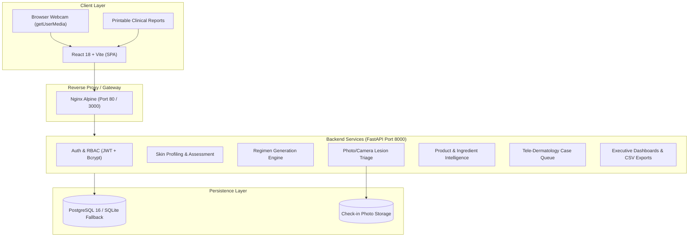

# 🧬 AI Skin Intelligence & Personalized Skincare Planner

An enterprise-grade, clinical-assisted AI skincare platform that creates personalized skincare regimens by analyzing a user's biometric profile, lifestyle habits, sleep patterns, environmental exposures, and facial skin conditions. 

Built with **FastAPI**, **React 18 / Vite**, **PostgreSQL / SQLite**, and containerized with **Docker & Nginx**.

---

## 🌟 Platform Capabilities & Milestones Completed

### Milestone 1: Authentication & Biometric Skin Profiling
- **Secure JWT Authentication**: Native bcrypt password hashing (no 72-byte truncation bugs) with OAuth2 bearer token authentication.
- **Biometric Skin Profiling**: Captures skin type (Dry, Oily, Combination, Sensitive, Normal), primary concern, allergies, sensitivities, lifestyle habits, water intake, sleep patterns, and environmental exposures.
- **Role-Based Access Control**: Differentiates between `user` (patient), `dermatologist`, and `admin` roles.

### Milestone 2: AI Assessment Engine & Personalized Routines
- **Multi-Factor Clinical Assessment**: Dynamic rule-based clinical scoring assessing barrier integrity, photoprotection compliance, lifestyle risk index, and concern prioritization.
- **Personalized Regimen Generator**: Custom morning, evening, and weekly regimens with ingredient guidance and contraindication filters.
- **Explainable AI Dermatology Triage**: Algorithmic decision support determining when dermatological consultation is warranted.

### Milestone 3: Pharmacopoeia, Product Matching & Tele-Dermatology
- **Ingredient Pharmacopoeia**: Searchable bio-actives catalog with safety ratings, comedogenic ratings, and profile compatibility scoring.
- **Product Match Engine & Multi-Product Comparison**: Algorithmic scoring of formulations against skin profile traits and side-by-side ingredient comparison.
- **Tele-Dermatology Clinical Queue**: End-to-end case creation, case acceptance by licensed doctors, bi-directional message threads, and prescription notes.

### Milestone 4: Executive Analytics, Computer-Assisted Check-ins & Production Deployment
- **Live Webcam & Gallery Photo Check-in**: Integrated browser camera capture stream (`getUserMedia`) alongside photo uploads with automated image quality verification (sharpness, brightness, contrast).
- **Structured Lesion Telemetry**: Quantitative tracking of pimples, scars (`has_scars`), stretch marks (`has_stretch_marks`), wrinkles (`has_wrinkles`), and 0–5 severity sliders for erythema, dryness, and irritation.
- **Executive Analytics Dashboard**: Cohort analytics, tele-dermatology completion rate, risk stratification, and lesion frequency distributions.
- **Clinical Summary Reports**: Authoritative, printable clinical summary reports with doctor sign-off blocks (`window.print()`).
- **Data Export Governance**: Dynamic CSV and complete JSON data exports for patient medical records.
- **Automated Testing Suite**: 100% passing automated test suite (`pytest`) verifying auth, profiles, recommendations, lesion check-ins, and executive reports.
- **PostgreSQL & Docker Containerization**: Multi-container Docker Compose setup (`db`, `backend`, `frontend`) with automatic fallback to zero-config SQLite for local development.

---

## 🏗️ System Architecture



---

## ⚡ Quick Start

### Option 1: Docker Compose (PostgreSQL + Backend + Frontend)
Requirements: [Docker Desktop](https://www.docker.com/)

```bash
# Clone the repository and navigate into it
cd ai-skin-intelligence

# Launch all 3 services in background
docker compose up --build -d
```

- **Frontend Application**: [http://localhost](http://localhost) (or [http://localhost:3000](http://localhost:3000))
- **Backend API**: [http://localhost:8000](http://localhost:8000)
- **API Swagger Docs**: [http://localhost:8000/docs](http://localhost:8000/docs)
- **PostgreSQL Database**: `localhost:5432`

---

### Option 2: Local Development (FastAPI + Vite + SQLite)

#### Backend Setup
```powershell
cd backend
python -m venv venv
.\venv\Scripts\Activate.ps1
pip install -r requirements.txt
uvicorn app.main:app --reload --port 8000
```

#### Frontend Setup
```powershell
cd frontend
npm install
npm run dev
```

The frontend will run on [http://localhost:5173](http://localhost:5173).

---

## 🧪 Automated Testing

The backend includes a comprehensive `pytest` test suite:

```powershell
cd backend
$env:PYTHONPATH="."
.\venv\Scripts\pytest -v tests
```

### Test Suite Coverage:
| Test File | Test Cases | Status |
| :--- | :--- | :--- |
| `test_auth.py` | User registration, login, JWT issuance, duplicate check, unauthorized guard | ✅ PASSED |
| `test_skin_profile_assessment.py` | Profile CRUD, AI assessment, personalized routines, triage | ✅ PASSED |
| `test_products_ingredients.py` | Product catalog, recommendations, multi-comparison, ingredient search | ✅ PASSED |
| `test_checkin_and_camera.py` | Live webcam base64 upload, file upload, structured lesion check-in | ✅ PASSED |
| `test_executive_and_reports.py` | Executive dashboard telemetry, clinical report, CSV & JSON exports | ✅ PASSED |

---

## 🔑 Demo Accounts

The database comes pre-seeded with verified test accounts:

| Role | Email | Password | Access Capabilities |
| :--- | :--- | :--- | :--- |
| **Patient** | `patient@demo.com` | `password123` | Skin profile, daily logs, camera check-in, AI routine, consultations |
| **Dermatologist** | `doctor@demo.com` | `password123` | Patient queue review, doctor responses, executive dashboard, clinical sign-offs |

---

## 🐙 GitHub Repository Setup

To push this codebase to your GitHub account, run the following commands in your own terminal (from the project root):

```bash
# 1. Initialize git
git init

# 2. Add all clean project files (.gitignore automatically excludes venv and node_modules)
git add .

# 3. Create initial milestone commit
git commit -m "feat: complete Milestones 1-4 for AI Skin Intelligence platform"

# 4. Set main branch
git branch -M main

# 5. Link your GitHub repository (replace with your repo URL)
git remote add origin https://github.com/YOUR_USERNAME/ai-skin-intelligence.git

# 6. Push code to GitHub
git push -u origin main
```

---

## 💻 VS Code Development
For complete instructions on running, debugging with breakpoints (F5), and running tasks inside Visual Studio Code, see [VSCODE_GUIDE.md](VSCODE_GUIDE.md).
