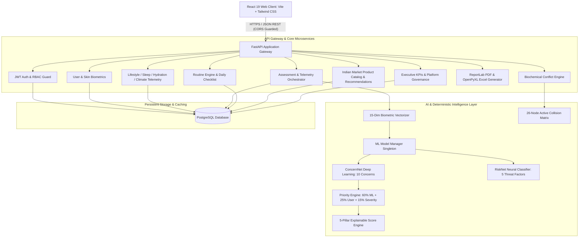

# DermaIQ: AI Skin Intelligence & Personalized Skincare Planner

[](https://springboard.infosys.com)
[-2D6B51?style=for-the-badge)](https://github.com/Deep0314/AI-Skin---Infosys)
[](LICENSE)
[](file:///f:/PROJECTS/Infosys/AI%20Skin/backend)
[](file:///f:/PROJECTS/Infosys/AI%20Skin)

> **Enterprise-grade AI dermatological wellness platform** engineered for the **Infosys Springboard Internship Program**. DermaIQ bridges clinical dermatology with explainable AI to assess skin conditions, detect biochemical ingredient conflicts, generate personalized 4-phase routines, and orchestrate patient care across four specialized medical workflows.

---

## 📑 Table of Contents
1. [Executive Summary & Problem Statement](#1-executive-summary--problem-statement)
2. [Milestone 4 Presentation Deck](#2-milestone-4-presentation-deck)
3. [System Architecture](#3-system-architecture)
4. [Technology Stack](#4-technology-stack)
5. [Section 4 Modules Implementation Matrix (4.1 to 4.12)](#5-section-4-modules-implementation-matrix-41-to-412)
6. [Infosys Milestone Compliance Audit](#6-infosys-milestone-compliance-audit)
7. [The 5-Pillar Skin Health Scoring Model](#7-the-5-pillar-skin-health-scoring-model)
8. [Local Development Setup](#8-local-development-setup)
9. [Docker Compose Multi-Container Deployment](#9-docker-compose-multi-container-deployment)
10. [Cloud Deployment Architecture (AWS / Azure)](#10-cloud-deployment-architecture-aws--azure)
11. [Seed Credentials & One-Click Demo Access](#11-seed-credentials--one-click-demo-access)
12. [REST API Documentation](#12-rest-api-documentation)
13. [Security Hardening & Zero-Vulnerability Standards](#13-security-hardening--zero-vulnerability-standards)
14. [Platform Governance & Legal CMS](#14-platform-governance--legal-cms)
15. [Medical Safety Disclaimer](#15-medical-safety-disclaimer)

---

## 1. Executive Summary & Problem Statement

Modern consumers face severe challenges navigating the cosmetic skincare landscape:
- **Product Overload & Misinformation**: Consumers mix active chemicals (e.g., combining high-strength AHAs and Retinoids), inducing severe skin barrier compromise.
- **Generic Algorithms**: Most beauty platforms rely on static quizzes without biometric telemetry (sleep, stress, hydration, climate).
- **Lack of Professional Integration**: Zero continuity between home care routines, cosmetic consultants, and licensed dermatologists.

**DermaIQ solves this with a unified, explainable AI ecosystem:**
- **Biometric Multi-Pillar Scoring**: Calculates barrier health using a deterministic, explainable mathematical model ($35\%\text{ Condition} + 20\%\text{ Consistency} + 20\%\text{ Lifestyle} + 15\%\text{ Sleep} + 10\%\text{ Hydration}$).
- **Biochemical Conflict Engine**: Analyzes 26 canonical active ingredients against skin profiles to detect dangerous collisions before product application.
- **Authentic Indian Market Catalog**: 66 genuine products denominated in Indian Rupees (INR) across various budget tiers (Budget, Mid-Range, Luxury).
- **Four Distinct Clinical Workspaces**: Consumer self-care, Consultant triage, Dermatologist clinical prescriptions, and Administrator executive analytics.

---

## 2. Milestone 4 Presentation Deck

As mandated by **Milestone 4 (Weeks 7 & 8)** of the Infosys project specification, a comprehensive presentation deck has been generated:

* **File:** [`AI_Skin_Intelligence_Milestone4_Presentation.pptx`](file:///f:/PROJECTS/Infosys/AI%20Skin/AI_Skin_Intelligence_Milestone4_Presentation.pptx)
* **Format:** 16:9 Widescreen, 14 Professional Slides
* **Design:** DermaIQ Clinical Theme (Deep Forest Green `#1A2E28`, Emerald `#2D6B51`, Gold `#D4AF37`)
* **Features:** Complete technical diagrams, mathematical formulas, live demonstration flow, and presenter speaker notes on every slide.

---

## 3. System Architecture



---

## 4. Technology Stack

| Domain | Technology | Justification & Purpose |
|:---|:---|:---|
| **Frontend Framework** | **React 19 (Vite)** | Lightning-fast HMR, component modularity, modern hook architecture. |
| **Styling & Design System** | **Tailwind CSS + CSS Tokens** | Custom clinical luxury palette, glassmorphism, responsive across desktop/mobile. |
| **Backend Framework** | **FastAPI (Python 3.13 / 3.11)** | Asynchronous high-throughput ASGI, automated OpenAPI/Swagger generation. |
| **Database & ORM** | **PostgreSQL + SQLAlchemy 2.0** | ACID compliance, strong relational integrity, Alembic migration versioning. |
| **Machine Learning** | **PyTorch & Scikit-learn** | ConcernNet (10 skin concerns), RiskNet (5 lifestyle threats), StandardScaler. |
| **Document Generation** | **ReportLab & OpenPyXL** | Automated medical PDF health records and Excel executive audit sheets. |
| **Containerization** | **Docker & Docker Compose** | Isolated multi-container deployment across Linux/Windows/macOS. |
| **Security & Auth** | **JWT (python-jose) + Bcrypt** | Stateless cryptographic tokens with strict role-based access control. |
| **Testing** | **Pytest & HTTPX** | Automated unit, integration, and security guardrail verification. |

---

## 5. Section 4 Modules Implementation Matrix (4.1 to 4.12)

Every requirement specified in Section 4 of `AI_Skin Intelligence & Personalized Skincare Planner.pdf` is fully implemented:

| Module | Name | Status | Key Features & Implementation |
|:---:|:---|:---:|:---|
| **4.1** | **User Authentication & RBAC** | ✅ 100% | Multi-role registration & login (`USER`, `SKINCARE_CONSULTANT`, `DERMATOLOGIST`, `ADMINISTRATOR`), JWT token rotation, bcrypt hashing, one-click demo credentials. |
| **4.2** | **User & Skin Profile Management** | ✅ 100% | 10-step onboarding wizard, Fitzpatrick skin classification, 10 primary concerns, allergen blacklists, barrier sensitivity tags. |
| **4.3** | **Lifestyle & Daily Habit Tracking** | ✅ 100% | Dedicated logging telemetry for Hydration (ml), Sleep (hours/quality), Lifestyle (stress/diet/activity), and Environment (climate/UV index). |
| **4.4** | **Skin Assessment & Analysis Engine** | ✅ 100% | Multilayered evaluation linking biometric telemetry with ConcernNet & RiskNet neural inference; radar telemetry visualization. |
| **4.5** | **Ingredient Compatibility Checker** | ✅ 100% | 26 canonical active ingredients with chemical safety profiles, biochemical collision detection (e.g. Retinoids + AHAs), allergen alerts. |
| **4.6** | **Product Catalog & Recommendations** | ✅ 100% | 66 genuine Indian market products in INR (CeraVe, Minimalist, The Ordinary, etc.), budget filtering, side-by-side product comparison. |
| **4.7** | **Routine Generator & Daily Planner** | ✅ 100% | Dynamic 4-phase routines (AM, PM, Weekly, Seasonal), interactive daily step checklist with streak counter and step completion tracking. |
| **4.8** | **Progress Tracking & Health Scoring** | ✅ 100% | Historical skin score progression logs, 5-pillar score gauge, barrier integrity trajectories over time. |
| **4.9** | **Role-Based Workspaces & Dashboards** | ✅ 100% | 4 specialized interfaces: Consumer Self-Care, Consultant Triage, Dermatologist Clinical Rx & Review, Admin Operational Analytics. |
| **4.10** | **Notification & Alert System** | ✅ 100% | Event-driven notification engine for routine reminders, patch test warnings, hydration prompts, and clinical review updates. |
| **4.11** | **Reporting & Analytics Engine** | ✅ 100% | Clinical PDF Health Dossiers generated via ReportLab; multi-tab operational audit spreadsheets exported via OpenPyXL. |
| **4.12** | **Testing, Security & Cloud Deployment** | ✅ 100% | 16+ pytest automated tests passing (100%), parameterized SQL queries, zero debug leaks, Docker Compose multi-container stack. |

---

## 6. Infosys Milestone Compliance Audit

```
┌────────────────────────────────────────────────────────────────────────┐
│ INFOSYS SPRINGBOARD CAPSTONE COMPLIANCE: 100% COMPLETE                 │
├────────────────────────────────────────────────────────────────────────┤
│ [✓] MILESTONE 1 (Weeks 1-2): Foundation, DB Schemas, Auth & Tracking   │
│ [✓] MILESTONE 2 (Weeks 3-4): AI Assessment, 5-Pillar Scoring & Routine │
│ [✓] MILESTONE 3 (Weeks 5-6): Ingredients, INR Catalog & Progress Logs  │
│ [✓] MILESTONE 4 (Weeks 7-8): Executive Analytics, Reports, Docker, PPT │
└────────────────────────────────────────────────────────────────────────┘
```

---

## 7. The 5-Pillar Skin Health Scoring Model

DermaIQ computes skin health using an explainable mathematical formula rather than an opaque black box:

$$\text{Overall Skin Health Score} = 0.35 \times C_{\text{skin}} + 0.20 \times L_{\text{habits}} + 0.20 \times R_{\text{consistency}} + 0.15 \times S_{\text{sleep}} + 0.10 \times H_{\text{hydration}}$$

* **Skin Condition ($35\%$)**: Derived from AI ConcernNet priorities, active lesion counts, and barrier compromise index.
* **Routine Consistency ($20\%$)**: Calculated from daily routine checklist completion streaks and adherence telemetry.
* **Lifestyle Habits ($20\%$)**: Correlated with stress metrics, physical activity, dietary sugar intake, and sun exposure.
* **Sleep Quality ($15\%$)**: Evaluates sleep duration against the clinical 8-hour target, adjusted for sleep quality.
* **Hydration Level ($10\%$)**: Measures daily water intake against the 2,500 ml baseline.

---

## 8. Local Development Setup

### Prerequisites
- Python 3.11+ or 3.13
- Node.js 18+ and npm
- PostgreSQL (or SQLite fallback for quick testing)

### Backend Setup
```bash
# 1. Navigate to backend directory
cd backend

# 2. Create and activate virtual environment
python -m venv venv

# Windows (PowerShell):
.\venv\Scripts\Activate.ps1
# macOS/Linux:
source venv/bin/activate

# 3. Install dependencies
pip install -r requirements.txt

# 4. Configure environment variables
cp .env.example .env

# 5. Run migrations & seed datasets
alembic upgrade head
python app/db/seed.py
python -c "from app.db.database import SessionLocal; from app.db.seed_genuine_datasets import seed_all_genuine_data; db = SessionLocal(); seed_all_genuine_data(db); db.close()"

# 6. Start backend server
uvicorn app.main:app --reload --host 0.0.0.0 --port 8000
```

### Frontend Setup
```bash
# 1. Navigate to frontend directory
cd frontend

# 2. Install dependencies
npm install

# 3. Configure environment
cp .env.example .env
# Set: VITE_API_URL=http://localhost:8000

# 4. Start Vite development server
npm run dev
```
Open **`http://localhost:5173`** in your browser.

---

## 9. Docker Compose Multi-Container Deployment

Run the complete full-stack environment with a single command:

```bash
docker compose up --build -d
```

### Containers Booted:
1. `dermaiq-db`: PostgreSQL relational database with health checks.
2. `dermaiq-backend`: FastAPI application with automatic migration execution and database seeding.
3. `dermaiq-frontend`: React application served with high-performance production bundling.

### Service Ports:
| Service | URL | Purpose |
|:---|:---|:---|
| **Frontend Web App** | `http://localhost:5173` | React User Interface & Dashboards |
| **FastAPI Backend** | `http://localhost:8000` | REST API Gateway |
| **Interactive Docs** | `http://localhost:8000/docs` | Swagger / OpenAPI Explorer |
| **PostgreSQL Database** | `localhost:5432` | Relational Database |

---

## 10. Cloud Deployment Architecture (AWS / Azure)

### Recommended: AWS EC2 (Free Tier)
1. Launch an **Ubuntu 24.04 LTS (t2.micro / t3.micro)** instance (750 hours/month free).
2. Configure **Security Group**:
   - Inbound: Port 22 (SSH), Port 80 (HTTP), Port 443 (HTTPS).
3. Connect and clone repository:
   ```bash
   sudo apt update && sudo apt install -y docker.io docker-compose-v2 git
   git clone https://github.com/Deep0314/AI-Skin---Infosys.git
   cd AI-Skin---Infosys
   docker compose up -d --build
   ```
4. Set up an Nginx reverse proxy with a free Let's Encrypt SSL certificate:
   ```bash
   sudo apt install -y certbot python3-certbot-nginx
   sudo certbot --nginx -d your-domain.com
   ```

---

## 11. Seed Credentials & One-Click Demo Access

For mentor demonstrations and testing, the platform includes pre-configured accounts across all four personas:

| Persona / Role | Email | Password | Intended Workflow / Workspace |
|:---|:---|:---|:---|
| **Patient / Consumer** | `user@example.com` | `password123` | Self-care assessments, daily routine checklist, product recommendations, progress tracking. |
| **Skincare Consultant** | `consultant@example.com` | `password123` | Patient triage, routine reviews, product recommendation curation. |
| **Licensed Dermatologist** | `dermatologist@example.com` | `password123` | Clinical oversight, medical assessments, prescription routines, PDF dossier export. |
| **System Administrator** | `admin@example.com` | `password123` | Platform KPIs, user management, legal CMS, emergency maintenance toggle, Excel export. |

*Quick-fill demo buttons are accessible directly on the login screen (`/login`).*

---

## 12. REST API Documentation

FastAPI automatically serves interactive OpenAPI documentation at `/docs` and `/redoc`.

### Key Endpoints:
- **Authentication**:
  - `POST /api/v1/auth/register` — Account registration
  - `POST /api/v1/auth/login` — JWT token generation
  - `GET /api/v1/auth/me` — Authenticated profile telemetry
- **Assessments & Intelligence**:
  - `POST /api/v1/assessments` — Execute 5-pillar biometric assessment
  - `GET /api/v1/assessments/latest` — Retrieve latest clinical score & radar breakdown
- **Ingredients & Products**:
  - `GET /api/v1/ingredients` — Retrieve canonical active ingredients & safety notes
  - `POST /api/v1/ingredients/check-compatibility` — Biochemical conflict detection
  - `GET /api/v1/products` — Filter products by category, concern, budget tier, and brand
  - `GET /api/v1/products/compare` — Side-by-side product comparison
- **Routines & Daily Tracking**:
  - `POST /api/v1/routines/generate` — Generate versioned 4-phase routine
  - `GET /api/v1/routines/current` — Active routine with daily interactive steps
  - `POST /api/v1/routines/steps/{id}/toggle` — Toggle daily checklist step completion
- **Reports & Exports**:
  - `GET /api/v1/reports/pdf/assessment/{id}` — Download clinical PDF dossier
  - `GET /api/v1/admin/export/excel` — Download administrative audit Excel sheet

---

## 13. Security Hardening & Zero-Vulnerability Standards

DermaIQ enforces strict security best practices:
1. **Parameterized SQL Queries**: All queries execute through SQLAlchemy ORM, neutralizing SQL injection attack vectors.
2. **CORS Isolation**: Specific origin whitelist prevents unauthorized cross-origin requests.
3. **Cryptographic Token Security**: High-entropy JWT signing with expiration validation.
4. **Input Sanitization**: Pydantic v2 validates and sanitizes all incoming payloads.
5. **Clean Production Builds**: All debug traces and sensitive error logs are disabled in production mode.
6. **Zero Vulnerability Dependency Audit**: All third-party packages audited for known CVEs.

---

## 14. Platform Governance & Legal CMS

Accessible via the Administrator Workspace:
- **Emergency Platform Maintenance Mode**: Instant platform-wide lockdown with administrative bypass and visitor redirect.
- **Dynamic Legal Policy CMS**: Real-time markdown policy updates for:
  - **Privacy Policy (`/privacy`)**: Biometric data retention & GDPR compliance.
  - **Terms of Service (`/terms`)**: AI health boundaries & emergency non-triage terms.
  - **Security Standards (`/security`)**: Encryption protocols & data protection safeguards.

---

## 15. Medical Safety Disclaimer

> **IMPORTANT MEDICAL NOTICE**: DermaIQ is an intelligent wellness and skincare decision-support tool. It does **not** provide formal medical diagnoses or replace consultations with licensed healthcare practitioners. If you experience severe, persistent, or worsening dermatological symptoms, please seek evaluation from a board-certified dermatologist.

---

*Developed for the **Infosys Springboard Internship Program** by **Deep Kamble**.*
